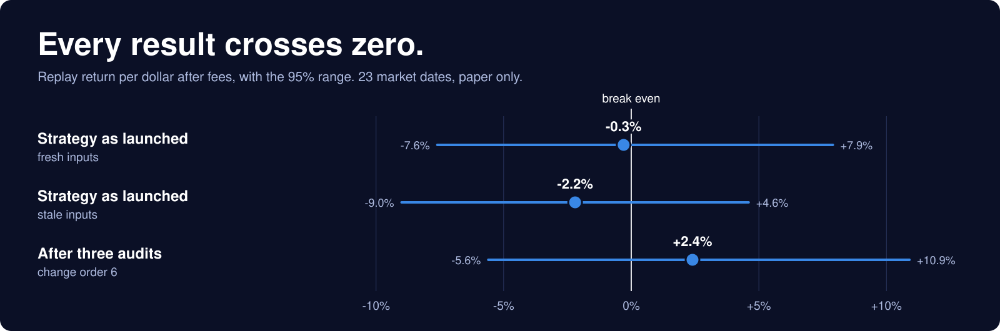

<p align="center">
  
</p>

# Can a weather model beat Polymarket's temperature markets after fees?

**A 300-tree model trained on nine global weather models, paper-traded against a live prediction market, audited
by three independent AIs, with the pass rule set before the results came in.**

**The answer so far: no detectable edge after costs.** This repository is the full record of how that was tested.

<table>
  <tr>
    <td align="center"><b>300</b><br>decision trees</td>
    <td align="center"><b>49</b><br>weather inputs</td>
    <td align="center"><b>50</b><br>airport stations</td>
    <td align="center"><b>1.13 °C</b><br>error, one day ahead</td>
    <td align="center"><b>6</b><br>change orders</td>
    <td align="center"><b>3</b><br>independent audits</td>
    <td align="center"><b>$0</b><br>real money traded</td>
  </tr>
</table>

<p align="center">
  
</p>

| Rule tested | Return per dollar | 95% range |
|---|---|---|
| Strategy as launched, fresh inputs | −0.3% | −7.6% to +7.9% |
| Strategy as launched, stale inputs | −2.2% | −9.0% to +4.6% |
| After three audits | +2.4% | −5.6% to +10.9% |

The model forecasts temperature well. Blended with the market's own price, it even picks the winning bucket slightly
better than the market two days ahead. That advantage is smaller than the fee and the spread. A paper-trading study,
run from 2026-10-19 and still open. **This repository contains no bot code** and nothing that can be run to trade.

## The short version

| Question | Finding | Where |
|---|---|---|
| Is the model better than raw weather forecasts? | Yes. Daily-high error 1.13 °C one day ahead against 1.52 °C for the raw nine-model mean, on a test window opened once | [docs/MODEL.md](docs/MODEL.md) |
| Does the model alone beat the market's price? | No. The market's price is the better forecast at every lead | [reports/edge_after_costs.md](reports/edge_after_costs.md) |
| Does model plus market beat the market? | Two days ahead, slightly: log-loss −0.04 (−0.06 to −0.02), better on 19 to 20 of 23 dates. One day ahead, no | same |
| Does that pay after the 5% fee and the spread? | Not shown. Best tested rule replays at +2.4% (−5.6% to +10.9%) | [docs/RESULTS.md](docs/RESULTS.md) |
| Did three earlier strategies make money? | No. One retired for losing to the market at every hour, one made −$2.13 on 295 settled bets, one stopped trading | [docs/TIMELINE.md](docs/TIMELINE.md) |
| What would count as success? | A rule fixed in advance: 60 market dates, four conditions, all must hold | [docs/RESULTS.md](docs/RESULTS.md) |

This is one strategy family on one market type. It does not show that nobody can profit there. It shows that this
approach, tested honestly, has not.

## How the work was run

```
┌──────────────┐   exports    ┌────────────────────┐  change order  ┌──────────────┐
│  Paper bot   │ ───────────▶ │ Analysis and model │ ─────────────▶ │    Owner     │
│ (cloud agent)│              │   (laptop, Claude) │                │  approves or │
└──────────────┘              └────────────────────┘                │   rejects    │
       ▲                               ▲                            └──────┬───────┘
       │                               │ findings                          │
       │                      ┌────────┴───────────┐                       │
       │                      │ Independent audits │                       │
       │                      │ Argon Carbon Astra │                       │
       │                      └────────────────────┘                       │
       └───────────────────── approved change applied ◀────────────────────┘
```

Rules that held throughout: paper only, risk caps never raised, ledger history never deleted, a retired strategy stays
retired, every change needs written evidence, and nobody approves their own work.

## What is in here

| Folder | Contents |
|---|---|
| [docs/](docs/) | Written for this repository: strategy, model, timeline, audits, results |
| [change_orders/](change_orders/) | The six change orders as written at the time, documents only |
| [audits/](audits/) | Three independent audits, the author's rebuttal, and the audit procedure |
| [reports/](reports/) | Generated research reports: baselines, tuning, costs, timing, power |
| [analysis/](analysis/) | Reviews of each data export |
| [model/](model/) | The model's settings and an interactive viewer of its trees |
| [assets/](assets/) | The two images on this page, drawn from the trained model and the replay report |

## Reading order

1. [docs/STRATEGY.md](docs/STRATEGY.md): what the bot bets on and why
2. [docs/MODEL.md](docs/MODEL.md): the gradient-boosted tree model
3. [docs/TIMELINE.md](docs/TIMELINE.md): every change from first to current
4. [docs/AUDITS.md](docs/AUDITS.md): what the reviewers found, right and wrong
5. [docs/RESULTS.md](docs/RESULTS.md): the numbers and the open evaluation

## Notes on the documents

The files outside `docs/` are the originals. They refer to code files, patches and server paths that are not published
here. Local machine paths are replaced with `<records>`. One embedded patch was removed from
`change_orders/2026-10-30/CO-003-ALT-...md` and is marked where it was.

Paper trading only. Nothing here is financial advice.
